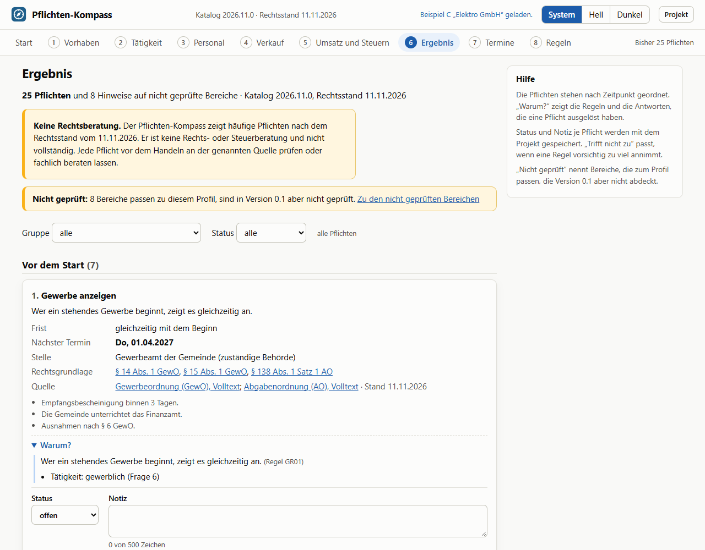
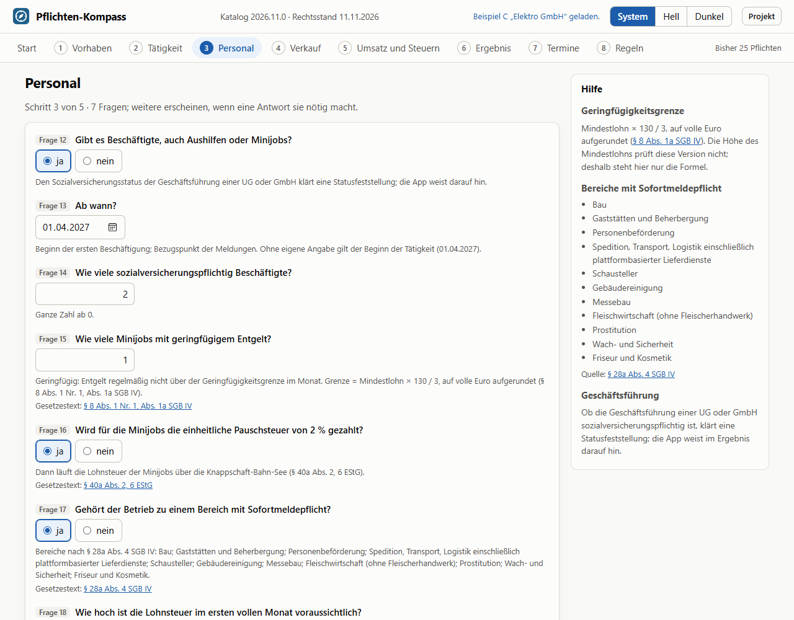
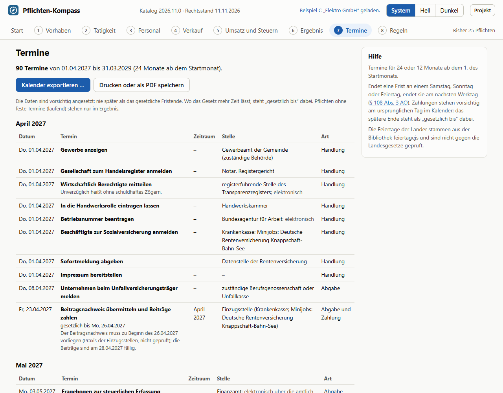
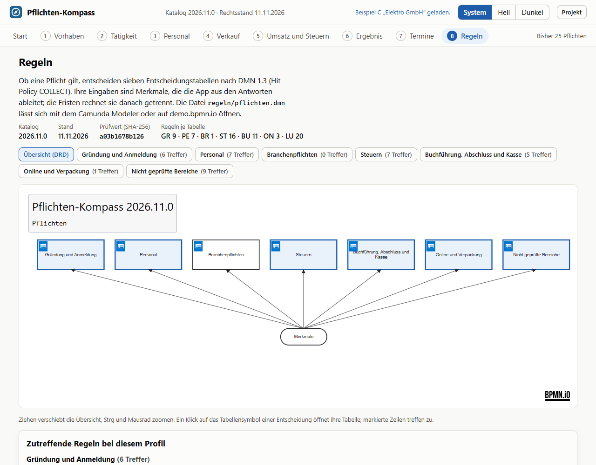
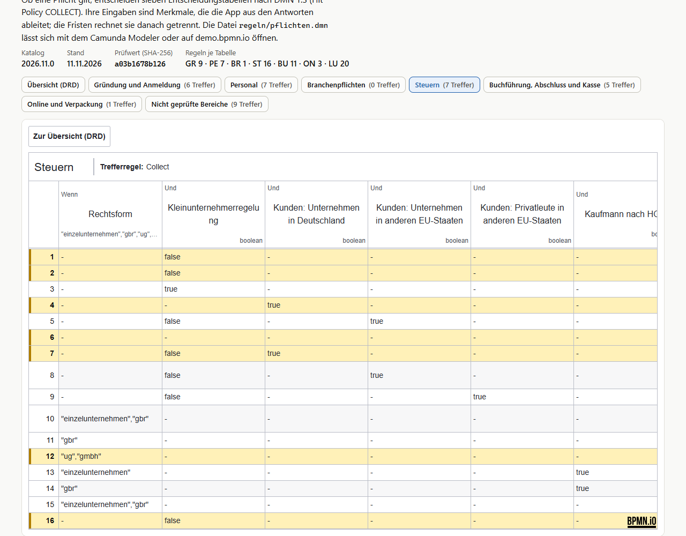

# Pflichten-Kompass

Zeigt Gründerinnen und Gründern, welche Anmeldungen, Meldungen und Fristen auf sie zukommen. Aus einem geführten Interview entsteht eine begründete Pflichtenliste mit Frist, zuständiger Stelle, Rechtsgrundlage, Quelle und Stand. Jede Pflicht nennt die Antworten, die sie ausgelöst haben, und die App sagt offen, welche Bereiche sie nicht geprüft hat. Dazu kommen ein Terminkalender mit den Feiertagen des Landes, ein Kalenderexport und eine Druckansicht. Die Regeln liegen als DMN-1.3-Entscheidungstabellen offen im Repo. Ein Windows-Programm ohne Server, ohne Konto und ohne KI; die Antworten bleiben auf dem eigenen Rechner.

> **Keine Rechts- oder Steuerberatung.** Der Pflichten-Kompass zeigt häufige Pflichten nach dem Rechtsstand vom 11.11.2026 (Regelkatalog 2026.11.0). Er ist keine Rechts- oder Steuerberatung und nicht vollständig. Jede Pflicht vor dem Handeln an der genannten Quelle prüfen oder fachlich beraten lassen.

## Herunterladen

**[Pflichten-Kompass für Windows herunterladen](https://github.com/edgebird-lab/pflichtenkompass/releases/latest/download/Pflichten-Kompass-Setup.exe)** (`Pflichten-Kompass-Setup.exe`, Version 0.1.0, rund 1,5 MB). Alle Versionen und Änderungen stehen unter [Releases](https://github.com/edgebird-lab/pflichtenkompass/releases).

- **Voraussetzung:** Windows 10 oder 11 (64 Bit) mit der WebView2-Laufzeit von Microsoft. Windows 11 bringt sie mit, auf Windows 10 ist sie meist schon da; sonst lädt der Installer sie nach (dafür braucht er einmal Internet).
- **Installation pro Benutzer, ohne Admin-Rechte:** Doppelklick auf die heruntergeladene Datei. Das Programm landet unter `%LOCALAPPDATA%\Pflichten-Kompass`, mit Eintrag im Startmenü, Verknüpfung auf dem Desktop und Dateizuordnung für `.pflichtenkompass`. Deinstallieren über Einstellungen → Apps.
- **Nicht signiert:** Der Installer trägt noch keine Code-Signatur. Windows SmartScreen kann deshalb beim Start warnen („Der Computer wurde durch Windows geschützt“); über „Weitere Informationen“ und „Trotzdem ausführen“ geht es weiter.
- **Kostenlos** und ohne Anmeldung; siehe [Rechte](#rechte).
- **Regelkatalog:** Version 2026.11.0, Rechtsstand 11.11.2026. Ein neuer Rechtsstand kommt nur mit einer neuen Version des Programms; die App zeigt den Stand oben in jeder Ansicht und an jeder Pflicht.



## Stand

Version 0.1.0 vom 11.11.2026, die erste veröffentlichte Version. Vor der Veröffentlichung kritisch geprüft: Regeln, Katalog und 71.264 Kalenderwerte eigenständig nachgerechnet, die Kalenderdatei mit einem fremden Parser gelesen, das PDF der Druckansicht Seite für Seite angesehen; elf Fehler und Lücken behoben, darunter zwei Abstürze (Liste in [docs/stand.md](docs/stand.md#prüfung-nach-phase-5-11112026)). Die fachliche Abnahme an echten Gründungsprofilen (Schritt 5.4) steht noch aus; bis dahin gelten die Annahmen in [docs/entscheidungen.md](docs/entscheidungen.md). Offen sind außerdem der Kalenderimport in Outlook und Google Kalender von Hand und der Katalog 2027.01 mit Gewerbe- und Körperschaftsteuer, Datenschutz und Fernabsatz (Phase 7). Die CI prüft Lint, Tests und Build, bei Änderungen am Programmteil zusätzlich das Windows-Programm samt Installer. Die Planung steht in der [Spezifikation](docs/spezifikation.md).

## Was es kann

- **Interview in fünf Schritten** (Vorhaben, Tätigkeit, Personal, Verkauf, Umsatz und Steuern) mit 32 Fragen, von denen je Profil rund 20 sichtbar sind. Jede Frage hat eine Hilfe mit Links auf die Normen; Fehler, offene Pflichtangaben und Warnungen stehen am Feld. Antworten mit Folgen für andere Fragen setzen deren Standard (Gastronomie → Lebensmittel und Sofortmeldung, Onlinehandel mit Privatkunden → Verpackung, Kasse → Bargeld).
- **Abgedeckt:** Einzelunternehmen, GbR (auch als OHG), UG (haftungsbeschränkt), GmbH; gewerblich oder freiberuflich; Handel, Onlinehandel, Handwerk, Gastronomie, Dienstleistung.
- **Kernkatalog 2026.11.0:** 40 geprüfte Pflichten und 17 Hinweise auf nicht geprüfte Bereiche ([Pflichtenkatalog](docs/katalog.md), [Fragenkatalog](docs/fragenkatalog.md)). Jede Pflicht hat Rechtsgrundlage, geöffnete Primärquelle und Stand.
- **Ergebnis** nach Zeitpunkt gruppiert (vor dem Start, erste Wochen, laufend, jährlich). Jede Pflichtkarte zeigt Frist, nächsten Termin mit „gesetzlich bis“, Stelle und Weg, Normen als Links, Quelle mit Stand, Hinweise und den Rechenweg der Termine. „Warum?“ nennt jede zutreffende Regel mit den erfüllten Bedingungen, z. B. „Beschäftigte: 3 (Fragen 12, 14, 15)“. Status (offen, erledigt, trifft nicht zu) und Notiz je Pflicht, Filter nach Gruppe und Status, Marke „neu“ für Pflichten, die seit dem letzten Blick dazugekommen sind.
- **Termine** für 24 oder 12 Monate ab dem Startmonat, nach Monaten geordnet, vergangene grau. Fristende nach § 108 Abs. 3 AO mit den Feiertagen des Landes, wiederkehrende Termine für Umsatzsteuer, Lohnsteuer, Sozialversicherung, Zusammenfassende Meldung und OSS, Jahresfristen für Erklärungen, Abschluss, Offenlegung und Verpackung.
- **Kalenderexport** als `.ics` nach RFC 5545 mit Erinnerung (keine, 1, 3, 7 oder 14 Tage vorher), wahlweise nur offene Pflichten; jeder Eintrag nennt Stelle, Rechtsgrundlage, Quelle und Stand und „Keine Rechts- oder Steuerberatung“.
- **Export im offenen Format Beratungsakte v1:** Der Knopf „Für die Beratungsakte speichern“ im Ergebnis fragt nach dem Mandanten (vorbelegt mit dem Namen des Vorhabens) und einer optionalen Mandantennummer und speichert eine JSON-Datei `<Mandant>-pflichtenkompass-<Datum>.beratungsakte.json`. Sie enthält jede Pflicht als Maßnahme (mit Stelle, Frist und nächstem Termin; Rechtsgrundlage, Quellen, Stand, Regeln und Status im Namensraum `pflichtenkompass`), Warnungen und nicht geprüfte Bereiche als Befunde, den Hinweis „keine Rechtsberatung“ als eigenen Befund und Anzahlen als Kennzahlen (siehe [Entscheidung E32](docs/entscheidungen.md)). Im Browser ein Download, im Programm der Speichern-Dialog von Windows. Die Bibliothek des Formats liegt als Kopie in `src/beratungsakte/` (Version in `src/beratungsakte/VERSION`, Beispieldateien in `testdaten/beratungsakte/`).
- **Druckansicht** (A4, immer hell) mit Kopf, je Gruppe einer Tabelle samt „Warum?“, den nicht geprüften Bereichen und den nächsten 12 Terminen; Hinweistext und Seitenzahl auf jeder Seite. PDF über „Als PDF speichern“ im Druckdialog.
- **Regelansicht** mit dmn-js: DRD und alle sieben Entscheidungstabellen, deutsch beschriftet, die Treffer des Profils markiert und zusätzlich als Liste; dazu die Quellen Q1–Q17.
- **Projektdatei** `.pflichtenkompass` (JSON) speichern und öffnen, auch per Strg+S und Strg+O oder durch Ziehen ins Fenster. Beim Öffnen nennt ein Änderungshinweis neue, entfallene und geänderte Pflichten seit dem Speichern; fremde, kaputte oder zu große Dateien lehnt die App mit Meldung ab. Die Antworten liegen außerdem im Browserspeicher; „Lokale Daten löschen“ entfernt sie. Lässt sich der gespeicherte Stand nicht lesen oder erlaubt der Browser kein Speichern, sagt die App das, statt Daten still zu verwerfen.
- Hell- und Dunkelmodus, vollständig per Tastatur bedienbar, geprüft mit axe; schmale Bildschirme ohne waagerechtes Scrollen.

| Interview | Termine |
| --- | --- |
|  |  |
| **Regeln (DRD)** | **Regeln (Tabelle „Steuern“)** |
|  |  |

## Windows-Programm

Dieselbe Oberfläche als installiertes Programm (Tauri 2 mit WebView2), gebaut aus [`src-tauri`](src-tauri) nach dem Vorbild des Prozesslotsen.

- **Installer** pro Benutzer ohne Admin-Rechte (NSIS, deutsch, 1,5 MB): legt den Pflichten-Kompass unter `%LOCALAPPDATA%\Pflichten-Kompass` ab, mit Eintrag im Startmenü, Verknüpfung auf dem Desktop und Eintrag unter „Apps“ zum Deinstallieren. Noch nicht signiert; SmartScreen fragt beim ersten Start nach.
- **Dateien:** `.pflichtenkompass` öffnet per Doppelklick im Programm, auch in einem schon laufenden (dann ohne zweites Fenster), oder durch Ziehen ins Fenster. „Speichern“ (Strg+S) schreibt in die geöffnete Datei, „Speichern unter“ (Strg+Umschalt+S) fragt nach dem Ort. Den Kalender (`.ics`) und die Beratungsakte (`.beratungsakte.json`) speichert der Dialog von Windows.
- **PDF der Druckansicht** direkt über WebView2, ohne Druckdialog: A4 mit Hinweistext und „Seite n von m“ auf jeder Seite. „Drucken …“ öffnet den Druckdialog.
- **Menüleiste** „Datei“ (Neu beginnen, Öffnen, Speichern, Speichern unter, Kalender exportieren, Drucken, Als PDF speichern, Beenden) und „Hilfe“.
- **Quellen und Normen** öffnen im Standardbrowser, nur mit https und nur für gesetze-im-internet.de, omg.org, rfc-editor.org und bpmn.io; das Programmfenster zeigt nie eine fremde Seite.
- **Sicherheit:** Die Oberfläche hat keine allgemeinen Dateirechte. Gelesen und geschrieben wird nur, was der Benutzer selbst gewählt hat (Dialog, Doppelklick, ins Fenster gezogen), atomar über eine Hilfsdatei; geöffnet werden höchstens 1 MB. Es gilt dieselbe strenge CSP wie in der Web-App, nur mit der Verbindung zum Rust-Teil. Die Antworten liegen wie im Browser nur auf dem Rechner (Speicher von WebView2 unter `%LOCALAPPDATA%\de.olbricht-digital.pflichtenkompass`) und werden beim Schließen gesichert.
- **Start:** Startseite nach rund 0,9 s, beim allerersten Start nach 1,4 s, weil WebView2 dann sein Profil anlegt (installierter Release-Build auf einem Testrechner; Debug-Build im Desktop-Test 1,1 s und 0,8 s).

## Beispiele

Sechs erfundene Gründungen sind auf der Startseite ladbar; ihre Ergebnisse sind als Golden Tests festgeschrieben (Spezifikation 9.3).

| Beispiel | Profil | Pflichten | Nicht geprüft |
| --- | --- | --- | --- |
| A Kaffeeversand | Einzelunternehmen, Onlinehandel, NW, Start 15.01.2027 | 13 | 7 |
| B Übersetzungsbüro | Einzelunternehmen, freiberuflich, Kleinunternehmer, HE | 9 | 4 |
| C Elektro GmbH | GmbH, zulassungspflichtiges Handwerk, 3 Beschäftigte, BY | 25 | 8 |
| D Café | GbR, Gastronomie, 3 Minijobs, elektronische Kasse, SN | 20 | 8 |
| E Shop UG | UG, Onlinehandel, Start 15.12.2026, BE | 20 | 9 |
| F Großhandel | Einzelkaufmann, 900.000 € Umsatz, HH | 22 | 6 |

Beispiel A ergibt für 24 Monate 31 Termine, darunter 23 Umsatzsteuer-Voranmeldungen.

## Rechenregeln

DMN entscheidet, *ob* eine Pflicht gilt; die Fristen rechnet TypeScript danach (`src/fristen`). Alle Funktionen bekommen „heute“, das Land und den Horizont übergeben.

| Berechnung | Regel | Norm |
| --- | --- | --- |
| Fristende | Monatsfrist: gleicher Tag im Zielmonat, sonst Monatsletzter; Ende am Samstag, Sonntag oder Feiertag → nächster Werktag | § 108 Abs. 3 AO |
| Abgaben und Zahlungen | Abgaben stehen am verschobenen Tag. Zahlungen (USt, Lohnsteuer, ESt-Vorauszahlung) stehen vorsichtig am ursprünglichen Tag, das spätere Ende als „gesetzlich bis“. OSS ohne Verschiebung | § 108 AO |
| Feiertage | aus feiertagejs je Land; „sicher“ (ohne Mariä Himmelfahrt in Bayern) zum Verschieben, „möglich“ (plus 24.12., 31.12., Fronleichnam in SN und TH, Augsburger Friedensfest) zum Zurückzählen. So kommt nie ein späteres Datum als im Gesetz heraus | Landesrecht nicht geprüft |
| USt-Voranmeldung | Gründungsjahr und Folgejahr monatlich; 2026 nach der voraussichtlichen Steuer (über 9.000 € monatlich, sonst vierteljährlich, bis 2.000 € Befreiung möglich); später vorsichtig monatlich. Fällig am 10. nach dem Zeitraum, mit Dauerfristverlängerung einen Monat später | § 18 Abs. 1, 2 UStG, § 46 UStDV |
| Sondervorauszahlung | Termin bei monatlicher Abgabe mit Dauerfristverlängerung: im ersten Jahr am Abgabetag der ersten Voranmeldung, danach am 10.02.; den Betrag (1/11) rechnet die App nicht | §§ 47, 48 UStDV |
| Lohnsteuer-Anmeldung | Monat über 5.000 €, Quartal über 1.080 €, sonst Jahr; im ersten Jahr Lohnsteuer des ersten Monats × 12, im zweiten als Schätzung | § 41a Abs. 2 EStG |
| SV-Beiträge | Fälligkeit am drittletzten Bankarbeitstag, Nachweis zwei Arbeitstage vorher; Termin einen Arbeitstag vor dem Nachweistag | §§ 23, 28f SGB IV |
| Steuererklärungen | 31.07. des Folgejahres; mit Steuerberatung letzter Februartag des übernächsten Jahres | § 149 Abs. 2, 3 AO |
| E-Rechnung ausstellen | ab 2027 bei mehr als 800.000 € Gesamtumsatz 2026 (ohne Angabe vorsichtig 2027), sonst ab 2028 | § 27 Abs. 38 UStG |
| Aufbewahrung | 31.12. des Jahres + 10 (Bücher, Abschlüsse), 8 (Belege, Rechnungen) oder 6 Jahre (Geschäftsbriefe); Rechner auf der Pflichtkarte | § 147 Abs. 3, 4 AO |
| Geringfügigkeitsgrenze | Mindestlohn × 130 / 3, auf volle Euro aufgerundet; die App zeigt nur die Formel | § 8 Abs. 1a SGB IV |
| Kleinunternehmer | Vorjahr höchstens 25.000 €, laufendes Jahr höchstens 100.000 €; im Gründungsjahr über 25.000 € ein Prüfhinweis; über 100.000 € rechnet die App ohne die Regelung und fragt dann auch nach Zahllast, EU-Fernverkäufen und Dauerfristverlängerung | § 19 Abs. 1 UStG |

Alle Werte der Tabellen DA, BA, US, LS, ER, AU, KU, GG und TE aus Abschnitt 9 der Spezifikation sind als Unit-Tests von Hand nachgerechnet. Bei der Prüfung am 11.11.2026 kam eine vom Code unabhängige Nachrechnung dazu: Werktage nach § 108 Abs. 3 AO, Arbeitstage und SV-Termine für jeden Tag von 2026 bis 2031 in allen 16 Ländern, ohne Abweichung.

## Grenzen

- **Nicht abgedeckt:** KG, GmbH & Co. KG, Verein; abweichendes Wirtschaftsjahr, mehrere Betriebsstätten, Reisegewerbe, erlaubnispflichtige Gewerbe, Kammerberufe; Gründungen vor dem 01.01.2026.
- **Nicht geprüft** und deshalb nur als Hinweis: Gewerbe- und Körperschaftsteuer, Gaststätten- und Lebensmittelrecht, Verbraucherrecht im Onlinehandel, Datenschutz, Arbeitsrecht und Arbeitsschutz, Erlaubnisse und Kammern, Künstlersozialabgabe, Rundfunkbeitrag, Elektrogeräte und Batterien, EU-Geschäft als Kleinunternehmer, freiberufliche UG oder GmbH, Vergütung der Geschäftsführung, dazu Prüfhinweise bei unklarer Kaufmannseigenschaft, unklarer Handwerksart und der Kleinunternehmergrenze im Gründungsjahr.
- **Vorsichtige Annahmen bis zur Klärung:** Höhe des Mindestlohns (nur Formel), DEÜV-Fristen (Termin am Beschäftigungsbeginn), § 18 Abs. 2 Satz 6 UStG ab 2027 (nach dem Wortlaut monatlich), Zeitpunkt des Beitragsnachweises und Bankarbeitstage (24.12. und 31.12. frei), OSS-Frist am Wochenende (keine Verschiebung). Die offenen Fragen O1–O16 stehen in der Spezifikation (10.2), die Annahmen in [docs/entscheidungen.md](docs/entscheidungen.md).
- Die Feiertage der Länder stammen aus feiertagejs und sind nicht gegen die Landesgesetze geprüft. Die Links auf gesetze-im-internet.de sind gegen das Muster der Datenbank geprüft, nicht online.
- **Kalender:** Manche Kalender übernehmen die Erinnerung beim Import nicht oder setzen eine eigene. Wie sich Outlook und Google Kalender verhalten, ist noch nicht von Hand geprüft; die Dateien sind mit ical.js (Mozilla) gegengelesen. Der Export braucht Web Crypto, also https oder localhost; sonst nennt der Dialog den Grund.
- **Druck:** Hinweistext und Seitenzahl stehen über die Seitenränder von CSS (`@page`) auf jeder Seite. Geprüft mit Edge; andere Browser sind nicht geprüft.
- **Barrierefreiheit:** Die dmn-js-Leinwand (Verschieben, Zoomen) ist nicht per Tastatur bedienbar; Ersatz sind die Knöpfe je Tabelle und die Liste der zutreffenden Regeln.

## Regeln als DMN 1.3

Ob eine Pflicht gilt, entscheiden sieben Entscheidungstabellen in [`regeln/pflichten.dmn`](regeln/pflichten.dmn) (Hit Policy COLLECT, 67 Regeln, jede mit Begründung). Ihre Eingaben sind 26 Merkmale, die TypeScript aus den Antworten ableitet. Die Einträge nutzen eine kleine, getestete Teilmenge von S-FEEL (`-`, Listen, `not(…)`, Vergleiche, Intervalle); alles andere lehnt der Lader ab. Beim Laden prüft die App die Datei (V1–V11): DMN-1.3-Namensraum, COLLECT, Ausgaben im Katalog, bekannte Merkmale und Typen, Begründung je Regel, eindeutige Regel-IDs, jede Pflicht und jede Lücke erreichbar. Ein Differenztest vergleicht die eigene Auswertung mit feelin über alle 570 Einträge der Datei. Der Prüfwert in [`regeln/stand.json`](regeln/stand.json) zwingt nach jeder Änderung zu neuer Katalogversion (V12). Die Datei öffnet sich auch im Camunda Modeler und auf demo.bpmn.io.

## Datenschutz

Keine Daten verlassen den Rechner: kein Server, keine Telemetrie, keine Konten, keine externen Schriften. Antworten liegen nur im Browserspeicher (im Windows-Programm im Speicher von WebView2) oder in der selbst gespeicherten Projektdatei. Im Produktions-Build und im Windows-Programm gilt eine strenge Content-Security-Policy.

## Aufbau

| Ordner | Inhalt |
| --- | --- |
| `src/modell` | Profil, Fragen, Antworten, Merkmale, Beispiele, Prüfungen, Speichern |
| `src/katalog` | Pflichten, Lücken, Quellen, Normlinks, Hinweistext |
| `src/regeln` | FEEL-Teilmenge, Laden und Prüfen der DMN-Datei, Auswertung |
| `src/fristen` | Datum, Feiertage, Berechnungen, Termine |
| `src/export` | Kalenderdatei (iCalendar), Export Beratungsakte v1 |
| `src/beratungsakte` | Kopie der Bibliothek des Formats Beratungsakte v1 (nicht von Hand ändern) |
| `src/plattform` | Öffnen, Speichern, Menü, Links: im Browser (`browser.ts`) und im Windows-Programm (`desktop.ts`) |
| `src/ui` | React-Oberfläche: Schritte, Pflichtkarte, Terminliste, Regelansicht (lazy), Druckansicht, Dialoge |
| `regeln` | `pflichten.dmn` (DMN 1.3) und ihr Prüfwert |
| `src-tauri` | Windows-Programm: Rust-Befehle (`src/lib.rs`), Rechte, CSP, Installer, Symbol (`icons/quelle.svg`), Installertest der CI |
| `e2e` | Browsertests mit Playwright und axe |
| `scripts` | Doku erzeugen, Prüfwert der Regeln, Bildschirmfotos, Desktop-Test |
| `docs` | [Spezifikation](docs/spezifikation.md), [Stand](docs/stand.md), [Entscheidungen](docs/entscheidungen.md), [Abnahme](docs/abnahme.md), [Pflichtenkatalog](docs/katalog.md), [Fragenkatalog](docs/fragenkatalog.md), [Lizenzen](docs/lizenzen.md), [Bilder](docs/bilder) |

Die Fachlogik kennt kein React und ist getestet; „heute“ wird ihr immer übergeben.

**Technik:** React 19, TypeScript 7, Vite 8, Vitest, Playwright mit axe, oxlint, GitHub Actions; dmn-moddle und dmn-js für DMN, feiertagejs für die Feiertage; Tauri 2 (Rust) für das Windows-Programm.

## Tests

- **Unit-Tests (Vitest, 375 in 27 Dateien):** FEEL-Teilmenge mit Differenztest gegen feelin, Prüfung des Regelwerks, Golden Tests der Beispiele A–F und gezielte Regeltests, Merkmale, Katalog, Speichern, Feiertage, Berechnungen, Termine, Kalenderexport, Export Beratungsakte (Beispiele A–F gültig, Zahlen, Stufen, Grenzfälle, Kopie der Bibliothek), Antworten, Anzeigetexte und Zustand; dazu die Regeln des Windows-Programms (Kennung, Dateizuordnung, CSP gleich der Web-App, Rechte nur für die eigenen Befehle, jede Quelle auf der Erlaubnisliste).
- **Browsertests (Playwright, lokal mit Edge, 45):** E1 Beispiel A nur mit der Tastatur, E2 Beispiele A–F, E3 Kalenderexport, E4 Druckansicht samt Fußzeile, E5 Datei speichern und öffnen, E6 Regelansicht ohne CSP-Meldung, E7 axe in allen Schritten hell und dunkel; Dialog „Für die Beratungsakte speichern“ mit Download und axe; dazu Sichtbarkeit der Fragen, Meldungen am Feld, Speicher, Tastatur, schmale Ansicht und die Fehlerfälle: fremde, kaputte und zu große Dateien, unlesbarer oder gesperrter Browserspeicher, Kalenderexport ohne Web Crypto, unsinnige Jahre im Aufbewahrungsrechner.
- **Windows-Programm:** `cargo test` (8 Tests: Dateiargumente, atomares Speichern, Binär- und zu große Dateien, Dateiarten, Endungen, Freigaben, Erlaubnisliste der Links, Navigationsschutz) und `npm run desktop:test` (59 Prüfpunkte am echten Programm ohne Installation: Start, Speichern unter und Speichern, Beratungsakte, Kalender, PDF in A4, Regelansicht mit dmn-js ohne CSP-Meldung, Quellenlink, abgelehnte Links, Pfade und Befehle, Navigationsschutz, Öffnen per Dialog, zweiter Start mit Datei, Sichern beim Schließen, Neustart mit Datei).
- **CI** (GitHub Actions): Lint, Unit-Tests und Build; die Browsertests laufen vorerst nur lokal (Entscheidung E1). Bei Änderungen am Programmteil baut `windows.yml` auf Windows Programm und Installer, führt `cargo test` aus und prüft den Installer (still installieren, Startmenü, Desktop-Verknüpfung, Dateizuordnung, Datei per Doppelklick öffnen, deinstallieren; Protokoll als Artefakt). `release.yml` baut bei einem Versions-Tag `v*` den Installer und hängt ihn zweimal an das Release: mit Versionsnummer im Namen und als `Pflichten-Kompass-Setup.exe` für den festen Download-Link; die Release-Notizen stehen in [`.github/release-notizen`](.github/release-notizen).

## Selbst bauen und starten

Wer den fertigen Installer nicht nutzen will, startet die App aus dem Quelltext, auch als Web-App im Browser. Mit Node 24 im Projektordner:

```bash
npm install
npm run build
npx vite preview --port 4182 --strictPort   # dann http://localhost:4182 öffnen
```

Die App braucht keinen Server außer dieser Vorschau und keine Konten.

**Windows-Programm:** nach der Installation über die Verknüpfung „Pflichten-Kompass“ auf dem Desktop, über das Startmenü oder per Doppelklick auf eine `.pflichtenkompass`-Datei. Den Installer selbst bauen (Rust stable mit MSVC, VS Build Tools 2022, Windows SDK):

```bash
npx tauri build   # Installer: <Zielordner>/release/bundle/nsis/Pflichten-Kompass_0.1.0_x64-setup.exe
```

Den Installer mit Doppelklick ausführen (pro Benutzer, ohne Admin) oder still mit `Pflichten-Kompass_0.1.0_x64-setup.exe /S`. Deinstallieren über „Apps“ in den Windows-Einstellungen.

## Entwickeln

```bash
npm install
npm run dev       # Entwicklungsserver (Port 5182)
npm test          # Unit-Tests (Vitest)
npm run e2e       # Browsertests gegen den Produktions-Build (Port 4182, lokal mit Edge)
npm run build     # Typprüfung und Produktions-Build
npm run lint      # oxlint
npm run doku      # docs/katalog.md und docs/fragenkatalog.md neu erzeugen
npm run regeln:stand   # Prüfwert der Regeldatei prüfen; nach Änderungen mit --version … --stand …
npm run desktop        # Windows-Programm mit Dev-Server (tauri dev)
npx tauri build --debug --no-bundle && npm run desktop:test   # Programm ohne Installation testen (CDP-Port 9334)
cargo test --manifest-path src-tauri/Cargo.toml                # Rust-Tests
```

Bildschirmfotos: `npm run build`, dann `npx vite preview --port 4182 --strictPort` starten und `node scripts/readme-bilder.mjs` (README) oder `node scripts/ansehen.mjs <ordner>` (Rundgang) ausführen. Die Vorschau danach wieder beenden, sonst testen die Browsertests den alten Build weiter.

## Rechte

© 2026 Robin Olbricht – olbricht-digital. Alle Rechte vorbehalten. Die Programme dürfen kostenlos genutzt werden; eine offene Lizenz ist noch nicht gewählt. Fremdbestandteile (bpmn.io/dmn-js u. a.) stehen unter ihren eigenen Lizenzen, siehe [docs/lizenzen.md](docs/lizenzen.md). dmn-js steht unter der bpmn.io-Lizenz, die das bpmn.io-Wasserzeichen in der Anzeige vorschreibt; die Regelansicht lässt es sichtbar.

Die verlinkten Gesetzestexte stammen von gesetze-im-internet.de; die App enthält nur eigene Kurzfassungen und Verweise, keine Texte von Kammern, Verbänden oder Verlagen.
